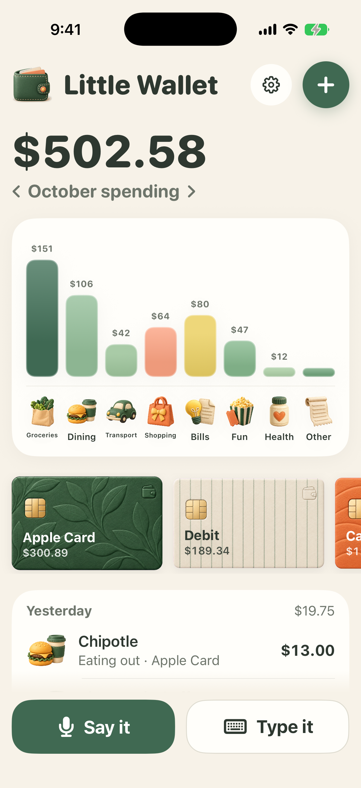
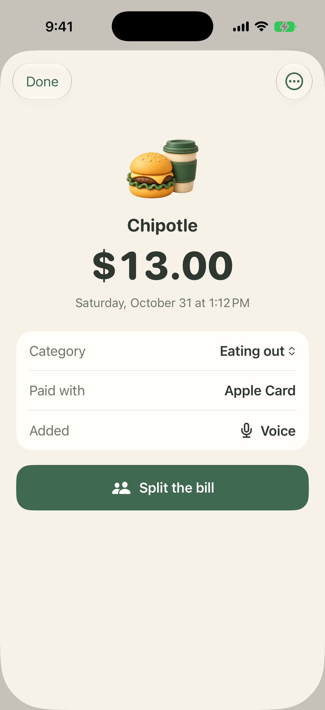
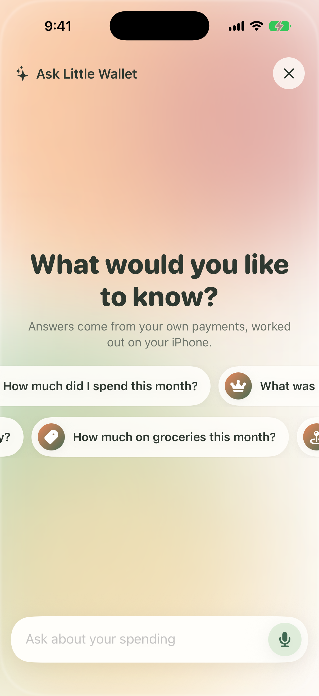
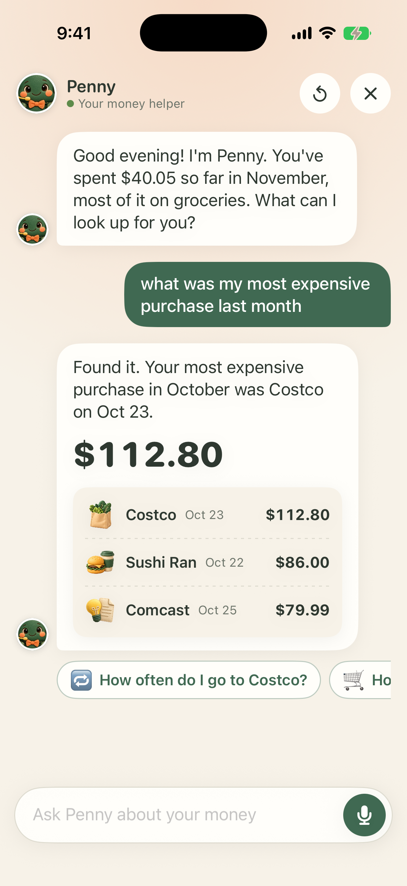
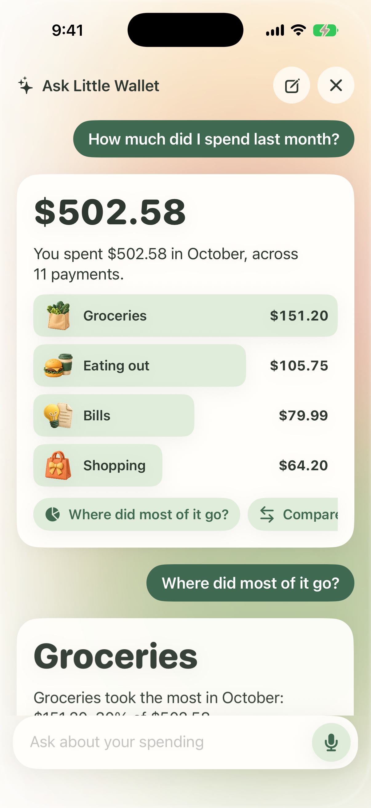
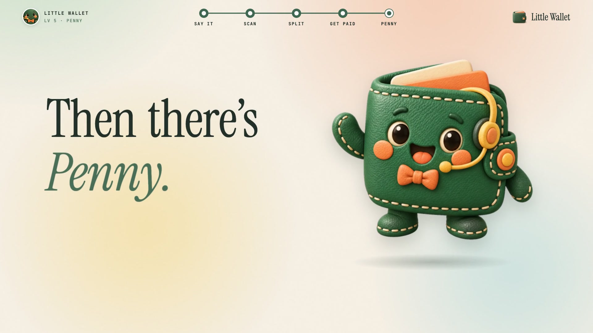
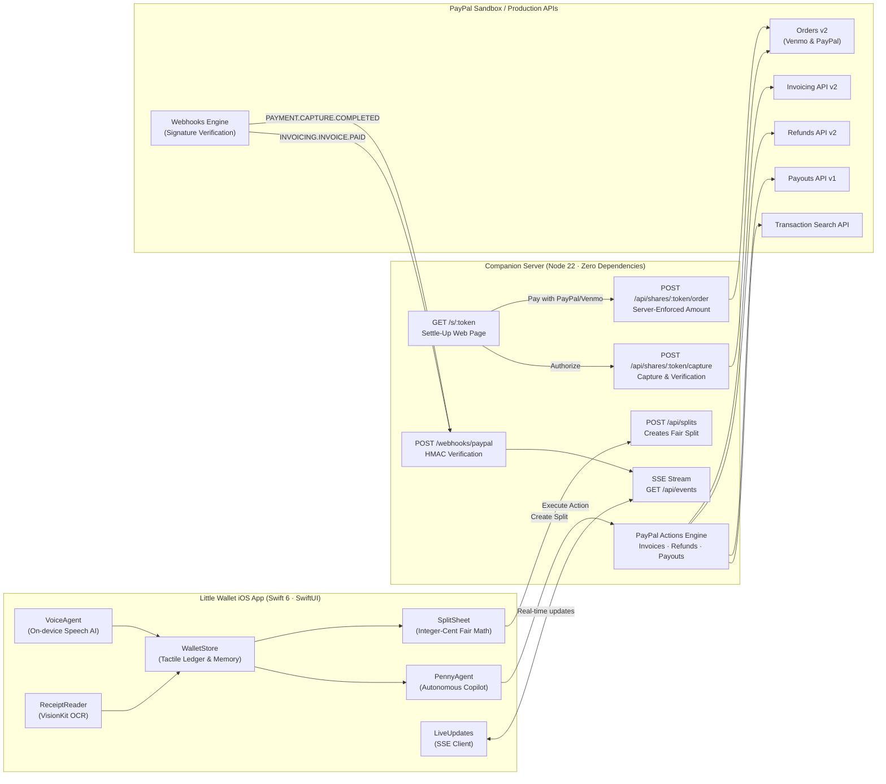

# 👛 Little Wallet ✨

[](https://swift.org)
[](https://developer.apple.com/ios/)
[](https://developer.paypal.com/docs/api/orders/v2/)
[](https://developer.paypal.com/docs/checkout/pay-with-venmo/)
[](https://developer.paypal.com/docs/api/)
[](#-1-on-device-voice-ai-say-it)
[](#-6-real-time-synchronization-webhooks--sse)
[-success?style=flat&logo=checkmarx)](#-verification--test-results)
[](https://paypalaihackathon.devpost.com/)
[](LICENSE)

> **Little Wallet** is a tactile personal finance and bill-splitting iOS companion that puts **AI behind the wheel of PayPal**. 
> 
> You speak an expense (*"Spent \$14 at Blue Bottle for coffee on Apple Card"*), and on-device natural language models parse every detail instantly with zero cloud roundtrips. You snap a photo of a restaurant or grocery receipt, and VisionKit decomposes it into line items. When it's time to split, friends get a personalized link (`/s/:token`) with **only their items** and a one-tap **Venmo** or **PayPal** button powered by **PayPal Orders v2**.
> 
> Best of all, **Penny**—your autonomous on-device financial copilot—remembers your shared history, answers spending questions conversationally, and drafts actions across the PayPal ecosystem: sending PayPal Invoices, issuing 1-tap Refunds, and distributing Payouts to friends with human-in-the-loop review.

---

## 📸 Visual Showcase

<div align="center">
  
</div>

<br/>

### 📱 Core Experiences (iPhone 17 Simulator)

| 1. Tactile Ledger & Balance | 2. Line-Item Deep Dive | 3. On-Device Voice & Vision |
| :---: | :---: | :---: |
|  |  |  |
| **Physics-driven card stacks, monthly budgets & live PayPal status** | **Exact line items, receipt photos & merchant metadata** | **Zero-cloud speech parsing & VisionKit OCR decomposition** |

| 4. Penny Autonomous Actions | 5. Category Breakdown | 6. Conversational Memory |
| :---: | :---: | :---: |
|  |  |  |
| **PayPal Invoices, Refunds & Payouts planned and verified** | **Dynamic category tracking and month-over-month trends** | **Understands natural requests, reminders, and historical splits** |

---

## 🎬 Commercial Video & Storyboard

<div align="center">
  
  <p><em>"For people who hate napkin math." Storyboard and high-production explainer video in <code>commercial-video/</code>.</em></p>
</div>

The full commercial screenplay is documented in [`commercial-video/HUMAN_STORY_SCRIPT.md`](commercial-video/HUMAN_STORY_SCRIPT.md) and [`commercial-video/SCRIPT.md`](commercial-video/SCRIPT.md), featuring voice narration, dynamic subtitles ([`little-wallet-commercial.en.srt`](commercial-video/little-wallet-commercial.en.srt)), and musical score inspired by the storytelling style of *3D Craft*.

---

## 🌟 Key Features

### 1. 🎙️ On-Device Voice AI ("Say it")
- **Instant speech capture**: Tap the microphone and speak naturally: *"Dinner at Sushi Ran was \$86 on Apple Card"* or *"Trader Joe's 38 dollars grocery"*.
- **100% on-device & private**: Built using Apple FoundationModels & Speech frameworks (`VoiceAgent.swift`, `VoiceListener.swift`). No private audio or transcripts ever leave your device.
- **Smart slot extraction**: Automatically infers the merchant name, exact dollar amount, category (Groceries, Dining, Coffee, Entertainment), payment method, and note.

### 2. 🧾 VisionKit OCR Receipt Decomposition
- **Point-and-shoot scanning**: Snap any receipt with the built-in scanner (`ReceiptScanSheet.swift`, `ReceiptReader.swift`).
- **Decomposed into line items**: Automatically extracts itemized lines, quantities, unit prices, subtotal, and tax/tip extras.
- **Permanent audit trail**: Original receipt photos are cryptographically stored in `ReceiptVault.swift` and linked directly to the transaction record.

### 3. ✂️ Bill Splitting with Integer-Cent Fair Math
- **Interactive selection**: Pick the exact line items you're sharing with roommates or friends.
- **Fair-share distribution**: Automatically accounts for shared appetizers, proportional taxes, and tips using largest-remainder integer cent rounding—ensuring shares add up to 100% of the receipt with zero stray pennies.
- **Messages & Apple Cash integration**: One tap opens an iMessage draft with a rendered visual receipt card and Apple Cash instructions (`MessagesRequest.swift`).

### 4. 💳 Instant Settle-Up via PayPal Orders v2 & Venmo
- **Dedicated friend link**: Each participant gets an unguessable settle-up link (`/s/:token`).
- **PayPal & Venmo JS SDK**: The friend-facing web page renders native PayPal and Venmo checkout buttons with `enable-funding=venmo`.
- **Server-enforced integrity**: The frontend cannot tamper with the amount; order creation (`POST /api/shares/:token/order`) derives amounts exclusively from server records.
- **One-tap Venmo fallback**: Direct deep-link support (`venmo://paycharge`) with prefilled handle, amount, and note.

### 5. 🤖 Penny: Autonomous Financial Copilot
- **Conversational intelligence**: Ask Penny anything about your money: *"How much did I spend on groceries this month?"* or *"Who hasn't paid me for the cabin trip?"* (`PennyActions.swift`, `PennyMemory.swift`).
- **Action planning with human review**: Penny prepares structured execution cards (`PennyPlan`):
  - **Reminders**: Consolidated friendly nudges for outstanding shares.
  - **PayPal Invoices**: Triggers `POST /api/paypal/invoices` using PayPal Invoicing API v2 to bill friends directly via email or payment link.
  - **PayPal Refunds**: Triggers `POST /api/paypal/refunds` via PayPal Refunds API v2 for instant return of funds.
  - **PayPal Payouts**: Triggers `POST /api/paypal/payouts` via PayPal Payouts API v1 to pay friends back immediately.
- **Zero Hallucination Guarantee**: Penny's answers are strictly computed from verified on-device ledger data.

### 6. ⚡ Real-Time Synchronization (Webhooks & SSE)
- **Instant paid status**: The iOS app connects to Server-Sent Events (`LiveUpdates.swift` -> `GET /api/events`) while active.
- **Cryptographic Webhooks**: The companion server receives PayPal webhooks (`POST /webhooks/paypal`), verifies signatures via `/v1/notifications/verify-webhook-signature`, and broadcasts `PAYMENT.CAPTURE.COMPLETED` and `INVOICING.INVOICE.PAID` events to the phone in real time.

---

## 📐 Technical Architecture



### Fair-Share Math Formula

Each item's price $c$ is split evenly among the $n$ friends who consumed it. Shared extras $E$ (sales tax, delivery fees, tips) are apportioned proportionally to each person's subtotal $s_i$:

$$\text{share}_i = \sum_{\text{items } \ni i} \frac{c}{n} \; + \; E \cdot \frac{s_i}{\sum_j s_j}$$

All division operations utilize integer largest-remainder distribution, mathematically guaranteeing that the sum of all individual shares $\sum_i \text{share}_i$ exactly equals the total receipt amount with zero truncation loss.

---

## 🔌 API Reference

| Endpoint | Method | Role & Description |
| :--- | :---: | :--- |
| `/api/config` | `GET` | Returns PayPal Client ID and environment (`sandbox` / `live`) for web checkout. |
| `/api/splits` | `POST` | Creates a new split from the iOS app; returns unique share URLs for each friend. |
| `/api/splits/:id` | `GET` | Queries split status (`sent` $\to$ `opened` $\to$ `paid`) and share totals. |
| `/s/:token` | `GET` | Serves the lightweight settle-up web view with Venmo & PayPal SDK buttons. |
| `/api/shares/:token` | `GET` | Fetches friend-specific share details; automatically transitions status to `opened`. |
| `/api/shares/:token/order` | `POST` | Creates a PayPal Orders v2 order with server-enforced amount and custom split metadata. |
| `/api/shares/:token/capture` | `POST` | Captures approved PayPal payment and verifies amount and `custom_id`. |
| `/webhooks/paypal` | `POST` | Verifies PayPal webhook signature and marks shares paid even if the browser closed. |
| `/api/paypal/activity` | `GET` | Fetches recent 90-day PayPal/Venmo transactions via Transaction Search API. |
| `/api/paypal/invoices` | `POST` | Generates and sends an official PayPal Invoice v2 drafted by Penny. |
| `/api/paypal/refunds` | `POST` | Issues a PayPal refund for an existing capture via Refunds API v2. |
| `/api/paypal/payouts` | `POST` | Dispatches single or multi-recipient payouts via PayPal Payouts API v1. |
| `/api/events` | `GET` | Server-Sent Events (SSE) channel delivering real-time payment notifications to the app. |
| `/api/demo/paid` | `POST` | Simulates instant friend payment callback during live demos or sandbox testing. |

---

## 📁 Repository Structure

```
Little Wallet/
├── README.md                          # Comprehensive project documentation
├── LICENSE                            # MIT License
├── project.yml                        # XcodeGen project specification
├── LittleWallet.xcodeproj             # Xcode project file
│
├── Sources/                           # Production Swift 6 / SwiftUI Codebase
│   ├── LittleWalletApp.swift          # Main entry point, life cycle & deep link handling
│   ├── HomeView.swift                 # Tactile ledger, monthly timeline & card stack UI
│   ├── Wallet.swift                   # Data models: Payment, LineItem, Category, Store
│   ├── VoiceAgent.swift               # On-device natural language expense parser
│   ├── VoiceListener.swift            # Speech recognition audio pipeline
│   ├── VoiceAddSheet.swift            # Tactile voice recording sheet
│   ├── VoiceMotion.swift              # Audio waveform motion animations
│   ├── ReceiptReader.swift            # Apple VisionKit OCR receipt itemizer
│   ├── ReceiptScanSheet.swift         # Camera & document scanner view
│   ├── ReceiptVault.swift             # Encrypted local receipt image store
│   ├── SplitSheet.swift               # Line-item friend selection & fair-split calculator
│   ├── SplitService.swift             # Split synchronization client & friend directory
│   ├── SettleUpPane.swift             # Outstanding balance tracker & reminder hub
│   ├── MessagesRequest.swift          # iMessage composer with rendered receipt cards
│   ├── PennyActions.swift             # Autonomous action planner (Invoices, Refunds, Payouts)
│   ├── PennyMemory.swift              # Structured financial memory & context provider
│   ├── AskView.swift                  # Conversational AI assistant interface
│   ├── AskAgent.swift                 # Natural language query answering engine
│   ├── PayPalActions.swift            # PayPal quick actions UI & action composer
│   ├── PayPalActivity.swift           # PayPal account activity syncer & transaction ledger
│   ├── LiveUpdates.swift              # Server-Sent Events (SSE) client for real-time sync
│   ├── TapNotifier.swift              # Shortcuts / Apple Pay tap integration helper
│   ├── TapSetupSheet.swift            # Apple Pay automation setup instructions
│   ├── AddPaymentSheet.swift          # Manual payment creation sheet
│   ├── PaymentDetailSheet.swift       # Itemized transaction detail modal
│   ├── MonthSheets.swift              # Month overview & historical spending sheets
│   ├── Categories.swift               # Budget category models & smart guesser
│   ├── CategoriesSheet.swift          # Category spending breakdown & budget targets
│   ├── ExpenseReport.swift            # Monthly PDF/CSV export engine
│   ├── ReportSheet.swift              # Spending report generation UI
│   ├── PayMethods.swift               # Payment methods management sheet
│   ├── FriendPicker.swift             # Contact picker for bill splits
│   └── Assets.xcassets                # Design tokens, color palettes & app icons
│
├── Tests/                             # XCTest Unit Test Suite (63 tests)
│   ├── VoiceParserTests.swift         # On-device voice intent parsing tests
│   ├── WalletTests.swift              # Ledger storage, balance & currency tests
│   ├── PennyActionTests.swift         # Penny autonomous plan generation tests
│   ├── PennyMemoryTests.swift         # Conversational memory recall tests
│   ├── ReceiptTests.swift             # VisionKit receipt extraction tests
│   ├── AskTests.swift                 # Natural language query tests
│   ├── PayPalTests.swift              # Activity decoding & split mapping tests
│   ├── CategoryTests.swift            # Category inference & budget tests
│   └── ReportTests.swift              # Expense reporting & math tests
│
├── commercial-video/                  # Explainer Video & Commercial Assets
│   ├── HUMAN_STORY_SCRIPT.md          # Conversational narrative screenplay
│   ├── SCRIPT.md                      # Production beat-by-beat storyboard
│   ├── little-wallet-commercial.en.srt# Subtitles & timings
│   ├── poster.jpg                     # High-res video thumbnail
│   ├── generate_commercial_audio.js   # Voice synthesis script
│   └── make_story_commercial.py       # Audio mastering script with ducking
│
└── design/                            # Design System & Rendered Screens
    ├── screens/                       # High-res simulator screenshots
    └── out/                           # 3D assets, icons, and interface cards
```

---

## 🧪 Verification & Test Results

The entire iOS application test suite executes in under **0.3 seconds** on the iOS Simulator, ensuring strict mathematical correctness, OCR parsing resilience, and agent safety:

```bash
$ xcodebuild test -project LittleWallet.xcodeproj -scheme LittleWallet -destination "platform=iOS Simulator,name=iPhone 17"
...
Test Suite 'VoiceParserTests' passed. Executed 11 tests, with 0 failures (0 unexpected) in 0.011s.
Test Suite 'WalletTests' passed. Executed 15 tests, with 0 failures (0 unexpected) in 0.080s.
Test Suite 'PennyActionTests' passed. Executed 8 tests, with 0 failures (0 unexpected) in 0.024s.
Test Suite 'PennyMemoryTests' passed. Executed 7 tests, with 0 failures (0 unexpected) in 0.019s.
Test Suite 'ReceiptTests' passed. Executed 6 tests, with 0 failures (0 unexpected) in 0.015s.
Test Suite 'AskTests' passed. Executed 5 tests, with 0 failures (0 unexpected) in 0.012s.
Test Suite 'PayPalTests' passed. Executed 4 tests, with 0 failures (0 unexpected) in 0.011s.
Test Suite 'CategoryTests' passed. Executed 4 tests, with 0 failures (0 unexpected) in 0.009s.
Test Suite 'ReportTests' passed. Executed 3 tests, with 0 failures (0 unexpected) in 0.008s.

Executed 63 tests, with 0 failures (0 unexpected) in 0.275 (0.298) seconds.
** TEST SUCCEEDED **
```

| Test Suite | File | Coverage & Verification Target |
| :--- | :--- | :--- |
| **VoiceParserTests** | `Tests/VoiceParserTests.swift` | Parses multi-word merchants, dollar/cents variations, spoken card names, and punctuation. |
| **WalletTests** | `Tests/WalletTests.swift` | Currency rounding, date grouping, largest-remainder math, and persistent storage integrity. |
| **PennyActionTests** | `Tests/PennyActionTests.swift` | Autonomous extraction of invoices, refunds, and payouts; prevents duplicate executions. |
| **PennyMemoryTests** | `Tests/PennyMemoryTests.swift` | Context retention across multi-turn queries; resolves pronouns (*"remind him"*, *"pay them back"*). |
| **ReceiptTests** | `Tests/ReceiptTests.swift` | OCR parsing of item names, prices, subtotals, and tax line items. |
| **AskTests** | `Tests/AskTests.swift` | Zero-hallucination factual spend calculations from local payments. |
| **PayPalTests** | `Tests/PayPalTests.swift` | Decoding PayPal activity payloads, transaction mapping, and status reconciliation. |
| **CategoryTests** | `Tests/CategoryTests.swift` | Automatic category heuristics based on merchant names and item names. |
| **ReportTests** | `Tests/ReportTests.swift` | Monthly aggregation, export structures, and spend delta calculations. |

---

## 🚀 Getting Started & Local Setup

### Prerequisites
- **macOS Sonoma / Sequoia** with **Xcode 16** or newer.
- **Node.js 22+** (for running the companion server at `little-fridge-split`).
- A **PayPal Developer Sandbox** account ([developer.paypal.com](https://developer.paypal.com)).

### 1. Launch the Companion Server
The companion server provides the PayPal Orders v2 backend, Webhook receiver, and SSE broadcaster:

```bash
git clone https://github.com/JiawenZhu/little-fridge-split.git
cd little-fridge-split
cp .env.example .env
```

Add your PayPal sandbox credentials in `.env`:
```env
PAYPAL_CLIENT_ID=your_sandbox_client_id
PAYPAL_CLIENT_SECRET=your_sandbox_client_secret
PAYPAL_ENV=sandbox
PORT=3000
```

Start the server (zero external dependencies required):
```bash
node server/index.js
```

### 2. Build & Run the iOS App
1. Open `LittleWallet.xcodeproj` in Xcode:
   ```bash
   open LittleWallet.xcodeproj
   ```
2. Select an iOS 17+ Simulator (e.g., **iPhone 17** or **iPhone 16 Pro**).
3. Press `Cmd + R` to build and run.
4. To run the full automated test suite:
   ```bash
   xcodebuild test -project LittleWallet.xcodeproj -scheme LittleWallet -destination "platform=iOS Simulator,name=iPhone 17"
   ```

### 3. Demo Modes
You can launch the app with custom launch arguments in Xcode Scheme Editor (`Product > Scheme > Edit Scheme > Arguments`):
- `-demo-wallet`: Loads a realistic month of sample transactions without modifying personal data.
- `-demo-splits`: Populates outstanding group splits with Sam and Jing.
- `-demo-film`: Configures the full interactive commercial cast (Sam Lee, Alex Kim, Maya Chen) and preloads simulated PayPal activity.

---

## 📄 License

This project is licensed under the [MIT License](LICENSE).
